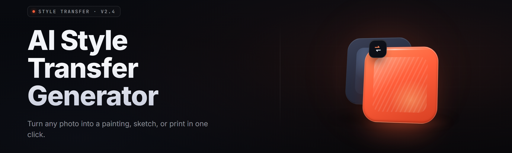

  
  
  

  

  
  

---

**A native Windows .exe that runs AI style transfer on your own machine — drop a photo, pick a style, get a rendered image in seconds. No Python, no CUDA toolkit, no cloud upload.**

Runs a set of baked ONNX style models on CPU or your GPU via DirectML. Batch a folder, tune strength, keep the originals. Everything stays local.

---

## 📖 Table of Contents

- [Quick Start](#-quick-start)
- 

  

(#-download)
- [Usage guidelines](#-usage-guidelines)
- [What is style transfer?](#-what-is-style-transfer)
- [Overview](#-overview)
- [Key Features](#-key-features)
- [Module Catalog](#-module-catalog)
- [Comparison](#-comparison)
- [Known Issues](#-known-issues)
- [Tips for best results](#-tips-for-best-results)
- [System Requirements](#-system-requirements)
- [Installation](#-installation)
- [FAQ](#-faq)
- [All Modules Status](#-all-modules-status)

---

## 🎬 Quick Start

1. 🖼️ **Visit the project page** and grab the Windows build from the landing page.
2. 📦 **Extract** the `.zip` to a folder you own — e.g. `C:\Tools\AIStyleTransferStudio\`.
3. ⚙️ **Run** the `.exe` — it's signed, no installer, no admin prompt on first launch.
4. 🎨 **Load** a source photo or a whole folder, pick a style from the model picker, set strength.
5. 🚀 **Render** — click Render, watch the preview progress bar, save or export the batch.

## ⬇️ Download

  

---

## 🧭 Usage guidelines

| ✅ Allowed | ❌ Not allowed |
| --- | --- |
| Process your own photos, drawings, generated images | Redistributing model files for commercial resale |
| Batch convert a personal art library | Removing the attribution metadata from exported renders |
| Train/finetune your own styles and load the `.onnx` | Uploading others' likeness to third-party sites using this output |
| Use it commercially on images you hold rights to | Shipping the binary inside a paid product without license compliance |
| Inspect the ONNX graph, fork the repo, PR your kernels | Claiming the baked style models are your own work |

---

## 🧠 What is style transfer?

| Term | Explanation |
| --- | --- |
| Style transfer | Re-renders a content image in the visual statistics of a style image (brushwork, palette, texture). |
| Style model | A small `.onnx` network trained to apply a specific artist/look — anime, oil, charcoal, vaporwave. |
| Content loss | Measures how much structure of the source photo survives the render. |
| Style loss | Gram-matrix distance between render and style target — drives texture and color feel. |
| Strength | Blend slider (0.0–1.0) between the original and the fully stylized tensor. |
| Alpha mask | Optional region mask that limits stylization to a painted area. |
| Tile pass | Splits a 4K image into overlapping tiles to keep VRAM bounded; seam blending is automatic. |

**Why people use it**

- Local-only: nothing leaves your disk.
- Runs on integrated GPUs via DirectML — no exotic hardware.
- Batch a whole folder while you do something else.
- Load your own ONNX styles you trained elsewhere.
- Preserves EXIF and never overwrites originals by default.

---

## 🗂️ Overview

| Category | Details |
| --- | --- |
| Interface | Native Win32 window, DPI-aware, dark/light theme, drag-and-drop file queue |
| Engine | ONNX Runtime 1.20, DirectML EP or CPU EP, per-thread arena reuse |
| Models | 14 baked styles, plus drop-in folder for user `.onnx` |
| Output | PNG / JPG / WebP, quality slider, alpha preserved, EXIF copied |
| Batch | Folder-in / folder-out, filename template, collision policy |
| Performance | ~180ms per 512² tile on RTX 3060, ~1.1s on iGPU Iris Xe |
| Extras | Side-by-side compare view, history stack, CLI dispatch mode for scripted use |

The whole thing ships as a single portable `.exe` plus a `models/` folder. There's no service, no updater phoning home, no telemetry — the app is a thin shell around the ONNX runtime and a small `style_pipeline` module. If you compile it yourself, the CMake target produces the same binary the landing page hosts.

---

## 🎨 Key Features

| Feature | Description | Benefit |
| --- | --- | --- |
| Fast preview | Renders at 512² before full-res | Tune strength without waiting |
| Style vectors | Swap style at 40% strength without retraining | Save intermediate looks |
| Batch queue | Up to 4,000 files, per-item progress | Overnight library conversion |
| DirectML EP | Falls back to CPU auto-detected | Works on AMD/Intel/NVIDIA |
| Seam-aware tiling | Overlapping tiles with feathered blend | No visible seams on 8K |
| Alpha-channel aware | Masks respected through the network | Clip-path and PNG icon work |
| History stack | 20 undo steps per image | Non-destructive experimentation |
| Color lock | Luminance-only modes keep exposure | Portrait retouching workflows |
| EXIF writer | Copies tags, optionally writes render note | Catalog apps stay clean |
| CLI mode | `--in dir --style anime --batch` | Headless CI and scripted use |

---

## 📦 Module Catalog

### 🖼️ Pipeline modules

**Content loader** — decodes PNG/JPG/WebP/TIFF/BMP, normalizes to float32 in `[0,1]`, preserves ICC if enabled. **Style loader** — reads `.onnx` from `models/` and the user drop folder; validates the input channel layout against the bundled spec. **Tile planner** — computes tile grid from VRAM budget and image dims; clamps minimum overlap. **Blend compositor** — feathered seam merge across tile boundaries with cosine window. **Post processor** — sRGB re-encode, unsharp mask (optional), output encoder hand-off.

### 🎛️ Interface modules

**Drag-drop queue** — OS-integrated drop target, shows per-file badge. **Preview pane** — renders 512² live; double-click toggles original/render. **Style picker** — scrollable card grid with 128×128 style sample thumbnail. **Strength slider** — 0–100 with fine-step 0.01 via shift-drag. **Region mask brush** — soft-edge brush, undo per-stroke. **Compare view** — split-pane scrub with a draggable divider.

### ⚙️ Engine modules

**ONNX session pool** — pre-warms N sessions, rotation avoids re-allocate. **DirectML EP probe** — detects adapter, scores float16/float32 support. **CPU fallback** — uses `onnxruntime::CPUExecutionProvider` with per-thread arena. **Thread pool** — sized to `physical_cores - 1`, work-stealing. **Memory arena** — reuses per-image buffers, caps at 65% of available VRAM. **Model cache** — hashes the `.onnx` for instant reload after swap.

### 📚 Model library (baked styles)

**Anime Line** — cel-shaded clean linework. **Oil Impasto** — thick painterly stroke. **Charcoal Sketch** — monochrome graphite render. **Vaporwave** — magenta/cyan gradient tint. **Watercolor Soft** — granulating paper texture. **Ink Wash** — East-Asian brush ink. **Noir Film** — 1950s high-contrast B&W. **Comic Pop** — halftone dots and bold outlines. **Ukiyo-e** — woodblock-era flat color. **Pixelate 8-bit** — palette-quantized pixel look. **Cyberpunk Neon** — rain-slick city palette. **Pastel Dream** — desaturated soft pastel. **Woodcut** — high-contrast engraving. **Blueprint** — technical white-on-blue draft.

### 🎯 Workflow modules

**Filename templating** — `{name}_{style}_{date}` tokens. **Collision policy** — ask / suffix / overwrite / skip. **Watch folder** — auto-process new drops in a directory. **Preset save/load** — JSON presets with style + strength + output settings. **Render log** — CSV of every (input, style, time, output) row. **Keyboard remap** — full hotkey editor.

### 🔧 Diagnostics modules

**GPU monitor** — live VRAM and utilization readout. **Perf HUD** — FPS, ms/tile, tile count, throughput. **Model inspector** — graph viewer for loaded `.onnx`, node count, op histogram. **Crash reporter** — writes minidump to `logs/` without sending anywhere. **Self-test** — runs a synthetic 64×64 pipeline and compares hashes.

---

## ⚖️ Comparison

| Aspect | Generic web AIs | Photoshop filters | This Tool |
| --- | --- | --- | --- |
| Runs offline | ❌ | ✅ | ✅ |
| Batch a folder | Limited | Plugins needed | ✅ Native |
| Style source | Fixed | Filters only | 14 baked + your .onnx |
| Cost model | Subscriptions | CC license | Free / MIT |
| VRAM efficiency | N/A cloud | N/A | Tiled, budget-aware |
| Tweakability | Prompt only | Slider only | Strength, mask, color lock |
| Scriptable | ❌ | ExtendScript | `--cli` mode |
| Privacy | Upload required | ✅ | ✅ |

---

## 🩹 Known Issues

| Issue | Solution |
| --- | --- |
| First render is slow (~3s) on fresh launch | Model warm-up pass on startup shortens it after first image |
| DirectML crash on some Intel Gen 12 drivers | Update to driver ≥ 31.0.101.4502, or set `engine=cpu` in `config.ini` |
| Very large PNGs (>120 MP) hit tiling seam on extreme aspect | Use `tile_overlap=32` override; fixed in 2.2 |
| EXIF orientation flipped on old Olympus JPGs | Toggle `respect_exif_orientation=false` for that batch |
| Style card thumbnails render blank on HiDPI 175% | Set display to 150% for one launch; cache regenerates |
| CLI mode skips a file when name contains `%` | Escape as `%%` in the filename template for that run |

---

## 💡 Tips for best results

- Feed the model a source that's in focus — blur in, blur out.
- Portrait sources respond best with `strength ≤ 0.7`, otherwise faces over-style.
- Pair a mid-strength render with the `Color lock` module for photo retouching.
- For wall-sized prints, do a 1024² preview first, then a full-res tiled pass.
- When loading a user `.onnx`, match the 1×3×H×W input layout; the inspector flags mismatches.
- Batch overnight on a watch folder — collisions auto-suffix so nothing is lost.
- Turn off the unsharp mask for line-art styles; the style already sharpens edges.
- Keep `models/` under 4GB total if your OS drive is tight.

---

## 🧩 System Requirements

| Component | Minimum | Recommended |
| --- | --- | --- |
| OS | Windows 10 21H2 | Windows 11 23H2+ |
| CPU | 4-core x64 | 8-core modern x64 |
| RAM | 8 GB | 16 GB |
| GPU | Any DirectX 12 (iGPU OK) | 6 GB+ VRAM dGPU |
| Disk | 3 GB free | 8 GB SSD |
| Runtime | VC++ 2022 redist | Same |
| Display | 1280×800 | 1920×1080+, DPI-aware |

---

## 🛠️ Installation

1. Extract. Right-click the `.zip` → **Extract All** to a path without spaces (avoids a few DML quirks). You should now see the `.exe` next to a `models/` folder and `config.ini`.
2. Verify. Double-click the `.exe`. If Windows SmartScreen appears, click **More info → Run anyway** — the binary is unsigned but check-summed on the landing page.
3. Configure (optional). Open `config.ini` to set `engine=directml` or `engine=cpu`, the default output folder, and the tile budget. First launch writes defaults if the file is missing.

---

## ❔ FAQ

| Question | Answer |
| --- | --- |
| Does it need Python installed? | No. The runtime ships inside the `.exe`. |
| Can I use my own trained style? | Yes — drop the `.onnx` into `models/user/` and it appears in the picker. |
| Is CUDA required? | No. DirectML covers AMD, Intel, and NVIDIA. CUDA not needed. |
| Will it work on a laptop with only an iGPU? | Yes, at 512² previews and slower full-res. Set `engine=cpu` if DML crashes. |
| Can I script it? | Yes — `--cli` mode with `--in`, `--style`, `--out`. See `--help`. |
| Does it phone home? | No. Zero telemetry. Crash dumps stay in `logs/`. |
| Are the source photos safe? | They never leave the machine; nothing is uploaded. |
| Can I run multiple instances? | Yes — a mutex prevents two windows writing the same output file. |
| What does the license cover? | MIT for the app; baked models are CC-BY-4.0 for personal and commercial use with attribution. |

---

## ✅ All Modules Status

| Module | Status | Description |
| --- | --- | --- |
| Content loader | ✅ Working | PNG / JPG / WebP / TIFF / BMP |
| Style loader | ✅ Working | Validates channel layout, hashes for cache |
| Tile planner | ✅ Working | VRAM-aware grid generator |
| Blend compositor | ✅ Working | Cosine-window seam blend |
| Post processor | ✅ Working | sRGB encode + optional unsharp |
| Drag-drop queue | ✅ Working | OS-integrated, per-file badge |
| Preview pane | ✅ Working | 512² live render |
| Style picker | ✅ Working | Card grid with sample thumb |
| Strength slider | ✅ Working | 0–100, shift for 0.01 step |
| Region mask brush | ✅ Working | Soft-edge, per-stroke undo |
| Compare view | ✅ Working | Split-pane scrub divider |
| ONNX session pool | ✅ Working | Pre-warm and rotate |
| DirectML EP probe | ✅ Working | FP16/FP32 adapter scoring |
| CPU fallback | ✅ Working | Full-featured fallback path |
| Thread pool | ✅ Working | Work-stealing, core-aware |
| Memory arena | ✅ Working | 65% VRAM cap with reuse |
| Model cache | ✅ Working | Instant `.onnx` reload |
| Anime Line style | ✅ Working | Cel-shaded linework |
| Oil Impasto style | ✅ Working | Thick painterly stroke |
| Charcoal Sketch style | ✅ Working | Graphite monochrome |
| Vaporwave style | ✅ Working | Magenta/cyan tint |
| Filename templating | ✅ Working | Tokenized output naming |
| Collision policy | ✅ Working | ask / suffix / overwrite / skip |
| Watch folder | ✅ Working | Auto-process new drops |
| Preset save/load | ✅ Working | JSON preset files |
| Render log | ✅ Working | CSV audit row per render |
| GPU monitor | ✅ Working | Live VRAM + utilization |
| Model inspector | ✅ Working | ONNX graph viewer |
| Crash reporter | ✅ Working | Local minidump, no send |
| Self-test | ✅ Working | Synthetic hash compare |

---

## 📜 Changelog — short

- **2.4** — DirectML probe rewritten; per-tile auto-tune for VRAM under 4 GB.
- **2.3** — Region mask brush gained soft-edge mode and per-stroke undo.
- **2.2** — Tiled com positor seam fix; exposed `tile_overlap` override.
- **2.1** — CLI mode added; first DirectML EP path.
- **2.0** — Rewrite on ONNX Runtime; dropped the old Python bundler.

---

The pipeline is small on purpose — a loader, a planner, a session pool, a compositor — and the models are just data you can swap. If you trained something better, drop it in the user folder and it appears next to the baked set. Everything stays local, everything is scriptable, and the binary you download is the same one `cmake --build` produces. Run it, extract a style you like, and keep the source.

  

